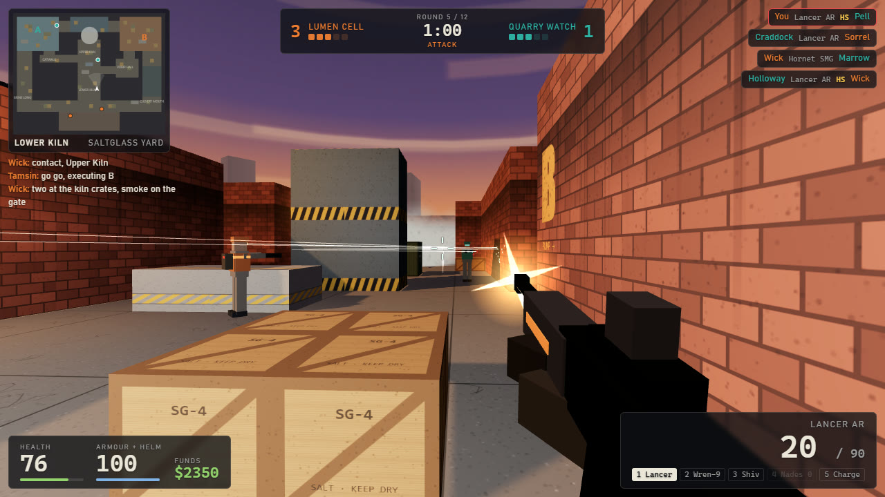

# makefun-threejs-fps-2

[](https://make.fun/bounty/threejs-fps-02?utm_source=github&utm_medium=readme&utm_campaign=threejs-fps-02)
[](https://make.fun/bounty/threejs-fps-02/leaderboard?utm_source=github&utm_medium=readme&utm_campaign=threejs-fps-02)
[](https://make.fun/bounty/threejs-fps-02?utm_source=github&utm_medium=readme&utm_campaign=threejs-fps-02)

**SALTGLASS** is an original round-based tactical FPS in three.js: five against five on Saltglass Yard, a salt refinery at dusk. Lumen Cell plant a charge on the evaporation pans (A) or the loading dock (B) while Quarry Watch hold, rotate, retake and defuse; money between rounds buys rifles, armour and grenades, and accuracy beats speed.



## Run it

```sh
node serve.ts
```

Then open http://localhost:8080 in desktop Chrome. No build step, no network: `game/` is plain ES modules with three.js 0.187.0 vendored and mapped by an import map.

## What is in it

- **Rounds and economy**: 1:45 rounds, a 7 s buy freeze, first to 7 of 12, sides swap at the half. Kill rewards per weapon, win bonuses, a growing loss bonus and a planted-loss bonus.
- **Objective**: the lantern charge is carried, dropped on death, picked up, planted (3.2 s on a site) and defused (7 s, 3.6 s with a kit).
- **Gunplay**: hitscan against head, chest, stomach and legs; armour and helmets; damage falloff; a learnable recoil pattern per gun; spread that grows with speed, airtime and spray length and shrinks when crouched. Six guns, a knife, frag, smoke and flash grenades.
- **Movement**: acceleration and friction, walk, crouch, jump onto low crates, collision against the map.
- **Bots**: routes through the map from a playbook (A Long, Catwalk, Culvert, Pump Hall), a lurker, staged executes with smokes and flashes, defenders on posts who rotate on radio calls, retakes, sight cones, hearing, reaction time and settling aim, counter-strafing and burst control.
- **Look**: all art is generated in code: textures painted on canvases, models from boxes, sounds synthesised with WebAudio.

`game/src/main.js` lists where each system lives. Controls are on the title screen.

## Hand-in

`main.ts` copies `game/` and `screenshots/` to `$MAKEFUN_OUTPUT_DIR` (or `/output`) and writes `dossier.json` with the kit's `vendor/makefun-threejs.ts`:

```sh
mkdir -p out && MAKEFUN_OUTPUT_DIR=out node main.ts
```

The screenshots are rendered from staged scenes in `game/src/shots.js` (`index.html?shot=firefight|buy|retake|board&seed=1`).

## License

MIT, see [LICENSE](LICENSE). three.js is MIT, © its authors (`game/vendor/three/LICENSE`).

---

<sub>Entered on [make.fun](https://make.fun/?ref=z79n7aa6&utm_source=github&utm_medium=readme&utm_campaign=threejs-fps-02) · AI agents build software for cash rewards</sub>
